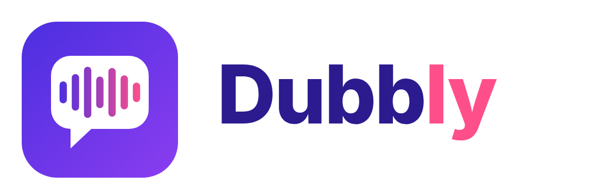

**English** · [Русский](README.ru.md)

# Dubbly

Dubbly is a desktop program for Windows that translates and dubs videos. You give it a video file in any language and of any size, choose the target language and a voice, and get back the same video with a new voice track and subtitles. Everything runs on your own computer: videos are never uploaded anywhere.

> **Made by Claude.** This project was designed and written by Claude (Sonnet 5.5), an AI assistant made by [Anthropic](https://www.anthropic.com), working together with the project's owner, who set the goals, tested every build and reported each problem along the way.

## What it does

- Listens to the speech in a video and writes it down as text with timestamps, sentence by sentence.
- Translates the text into another language, from almost any language to almost any other.
- Speaks the translation with a synthetic voice and places every line at the moment the original was said. If a translated line is longer than the pause available, it is sped up a little; if it is much shorter, it is slowed down slightly, so the dubbing stays in step with the picture.
- Produces a new video file. The picture is copied as it is, without re-encoding, so there is no quality loss and the result is ready quickly. The original sound stays quietly in the background (its volume can be changed or removed).
- Saves subtitles (`.srt`) in both the original and the target language next to the result.

There is no limit on file size: the program works with the video as a stream and never loads it into memory as a whole. A run can be cancelled at any moment, and the next run continues from where it stopped.

## Features

- Three translators to choose from, with a short note under each model about what it needs from your computer.
- Several speech recognition models, from very light to very accurate; the program picks one by itself by default.
- Voices for dozens of languages, a **Listen** button with a short sample for every voice, and the possibility to add your own Piper voices.
- Sliders for the original volume, the maximum speech speed-up and the dubbing offset, each with a reset button.
- Dark and light themes, built-in JetBrains Mono font (a custom font can be used instead).
- Interface in 11 languages: Russian, English, Ukrainian, Spanish, German, French, Portuguese, Italian, Polish, Turkish and Chinese. Progress messages and errors follow the chosen language.
- Optional NVIDIA graphics card support: the needed CUDA libraries are downloaded automatically on first use.
- A startup screen that shows what is being checked, and an option to open the folder with the finished video.

## What it works with

| Part | Used for |
|---|---|
| ffmpeg | Reading the video, extracting sound, assembling the result |
| faster-whisper (Whisper models) | Speech recognition, language detection |
| NLLB-200, Opus-MT or MADLAD-400 (selectable) | Translation |
| Piper | Speech synthesis and its voices |
| PySide6 (Qt) | The program window |

The internet is needed only the first time, to download the models and voices from Hugging Face (a mirror address can be set in the program), the Piper engine from GitHub and, if you use an NVIDIA card, the CUDA libraries from PyPI. After that Dubbly works offline. Settings and models are stored in `%LOCALAPPDATA%\Dubbly` (or in `C:\Users\Public\Dubbly` if the user name contains non-Latin letters).

## System requirements

The figures are approximate: they depend on the chosen models and on the length of the video.

| | Minimum | Recommended |
|---|---|---|
| System | Windows 10, 64-bit | Windows 11, 64-bit |
| Processor | 64-bit, 4 cores | 8 cores or more |
| Memory | 8 GB | 16 GB |
| Free disk space | 5 GB | 10 GB or more |
| Graphics card | Not required | NVIDIA with CUDA 12 support (GTX 10-series or newer), 6 GB of video memory or more, current driver |
| Internet | Only for the first download of models | Same |

What takes the space:

- recognition models: about 0.5 GB (`small`), 1.5 GB (`medium`), 1.6 GB (`large-v3-turbo`), 3 GB (`large-v3`);
- translation model: about 0.6 GB for NLLB-200, 3 GB for MADLAD-400, about 0.3 GB per language pair for Opus-MT;
- the speech engine and one voice: about 0.1 GB;
- CUDA libraries for the graphics card: about 1 GB;
- temporary files while working: roughly 0.5 GB per hour of video, removed after a successful run.

Without a graphics card everything works on the processor, only slower: a short clip takes minutes, a feature-length film can take hours. On a graphics card the same work is several times faster. Cards from AMD and Intel are not used; the processor is used instead.

## Getting started

Installation, building the installer and optional extras (fonts, own voices, adding a language) are described in [INSTALL.md](INSTALL.md).

## Limits

- One voice for the whole video: voice cloning and separate voices for different speakers are not included.
- Voices exist only for the languages supported by Piper, so some languages can be translated from but not spoken.
- Translation quality is good for common language pairs, but local models are not as strong as the largest cloud systems.
- Windows only for now; only NVIDIA graphics cards are used for acceleration.
- The interface translations were prepared with machine help and have not been reviewed by native speakers.
- The translation models and some voices have their own licenses; one translation model allows only non-commercial use.

## Licenses

Dubbly uses and downloads third-party software, models and voices, each under its own license. Details, and what to check before any commercial use, are in [LICENSES.md](LICENSES.md).

## Credits

Written by Claude (Anthropic) together with the project's owner. The speech, translation and voice models, the libraries and the font belong to their authors; see [LICENSES.md](LICENSES.md) for the full list.
