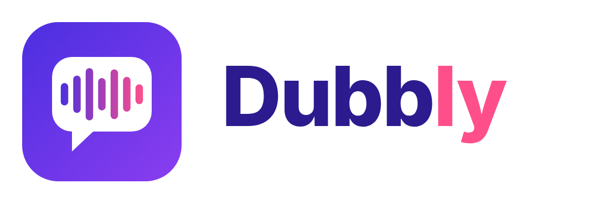

[English](README.md) · **Русский**

# Dubbly

Dubbly — программа для Windows, которая переводит и озвучивает видео. Вы даёте ей видеофайл на любом языке и любого размера, выбираете язык перевода и голос и получаете то же видео с новой звуковой дорожкой и субтитрами. Всё выполняется на вашем компьютере: видео никуда не отправляется.

> **Сделано Claude.** Этот проект придумал и написал Claude (Sonnet 5.5), ИИ-ассистент компании [Anthropic](https://www.anthropic.com), вместе с владельцем проекта, который поставил цели, проверил каждую сборку и сообщал о каждой проблеме по ходу работы.

## Что она делает

- Слушает речь в видео и записывает её текстом с привязкой ко времени, предложение за предложением.
- Переводит текст на другой язык, почти с любого языка на почти любой.
- Озвучивает перевод синтетическим голосом и ставит каждую реплику в тот момент, когда звучал оригинал. Если перевод длиннее доступной паузы, он немного ускоряется, а если заметно короче, слегка замедляется, чтобы озвучка шла в такт с картинкой.
- Собирает новый видеофайл. Картинка копируется как есть, без перекодирования, поэтому качество не теряется, а результат готов быстро. Оригинальный звук остаётся тихо на фоне (его громкость можно менять или убрать).
- Сохраняет рядом с результатом субтитры (`.srt`) на языке оригинала и на языке перевода.

Размер файла не ограничен: программа работает с видео потоком и никогда не загружает его в память целиком. Работу можно отменить в любой момент, а следующий запуск продолжит с того же места.

## Возможности

- Три переводчика на выбор, под каждой моделью короткая подсказка о том, что она потребует от компьютера.
- Несколько моделей распознавания речи, от очень лёгких до очень точных; по умолчанию программа выбирает сама.
- Голоса для десятков языков, кнопка **«Прослушать»** с коротким примером для каждого голоса и возможность добавить собственные голоса Piper.
- Ползунки громкости оригинала, максимального ускорения речи и сдвига озвучки, у каждого кнопка сброса.
- Тёмная и светлая темы, встроенный шрифт JetBrains Mono (можно использовать свой).
- Интерфейс на 11 языках: русский, английский, украинский, испанский, немецкий, французский, португальский, итальянский, польский, турецкий и китайский. Сообщения о ходе работы и ошибки идут на выбранном языке.
- Необязательная поддержка видеокарты NVIDIA: нужные библиотеки CUDA скачиваются автоматически при первом использовании.
- Заставка при запуске, где видно, что проверяется, и возможность открыть папку с готовым видео после завершения.

## С чем она взаимодействует

| Компонент | Для чего |
|---|---|
| ffmpeg | Чтение видео, извлечение звука, сборка результата |
| faster-whisper (модели Whisper) | Распознавание речи, определение языка |
| NLLB-200, Opus-MT или MADLAD-400 (на выбор) | Перевод |
| Piper | Синтез речи и его голоса |
| PySide6 (Qt) | Окно программы |

Интернет нужен только в первый раз: чтобы скачать модели и голоса с Hugging Face (адрес зеркала можно указать в программе), движок Piper с GitHub и, если вы используете видеокарту NVIDIA, библиотеки CUDA с PyPI. Дальше Dubbly работает без сети. Настройки и модели хранятся в `%LOCALAPPDATA%\Dubbly` (или в `C:\Users\Public\Dubbly`, если в имени пользователя есть не латинские буквы).

## Системные требования

Цифры приблизительные: они зависят от выбранных моделей и длины видео.

| | Минимум | Рекомендуется |
|---|---|---|
| Система | Windows 10, 64-бит | Windows 11, 64-бит |
| Процессор | 64-бит, 4 ядра | 8 ядер и больше |
| Память | 8 ГБ | 16 ГБ |
| Свободное место на диске | 5 ГБ | 10 ГБ и больше |
| Видеокарта | Не обязательна | NVIDIA с поддержкой CUDA 12 (GTX 10-й серии и новее), от 6 ГБ видеопамяти, свежий драйвер |
| Интернет | Только для первой загрузки моделей | То же |

На что уходит место:

- модели распознавания: около 0,5 ГБ (`small`), 1,5 ГБ (`medium`), 1,6 ГБ (`large-v3-turbo`), 3 ГБ (`large-v3`);
- модель перевода: около 0,6 ГБ у NLLB-200, 3 ГБ у MADLAD-400, около 0,3 ГБ на пару языков у Opus-MT;
- движок озвучки и один голос: около 0,1 ГБ;
- библиотеки CUDA для видеокарты: около 1 ГБ;
- временные файлы во время работы: примерно 0,5 ГБ на час видео, после успешного завершения удаляются.

Без видеокарты всё работает на процессоре, только медленнее: короткий ролик обрабатывается минуты, полнометражный фильм может занять часы. На видеокарте та же работа идёт в несколько раз быстрее. Видеокарты AMD и Intel не используются, вместо них работает процессор.

## Начало работы

Установка, сборка установщика и дополнительные возможности (шрифты, свои голоса, добавление языка) описаны в [INSTALL.ru.md](INSTALL.ru.md).

## Ограничения

- Один голос на всё видео: клонирования голоса и отдельных голосов для разных говорящих нет.
- Голоса есть только для языков, которые поддерживает Piper, поэтому с некоторых языков можно переводить, но нельзя на них озвучивать.
- Качество перевода хорошее для распространённых пар языков, но локальные модели слабее самых крупных облачных систем.
- Пока только Windows; для ускорения используются только видеокарты NVIDIA.
- Переводы интерфейса сделаны с помощью машинного перевода и не проверены носителями языков.
- У моделей перевода и некоторых голосов свои лицензии; одна из моделей перевода разрешает только некоммерческое использование.

## Лицензии

Dubbly использует и скачивает сторонние программы, модели и голоса, у каждого своя лицензия. Подробности и то, что нужно проверить перед любым коммерческим использованием, в [LICENSES.ru.md](LICENSES.ru.md) (английская версия: [LICENSES.md](LICENSES.md)).

## Авторство

Написано Claude (Anthropic) вместе с владельцем проекта. Модели распознавания, перевода и озвучки, библиотеки и шрифт принадлежат их авторам: полный список в [LICENSES.ru.md](LICENSES.ru.md).
